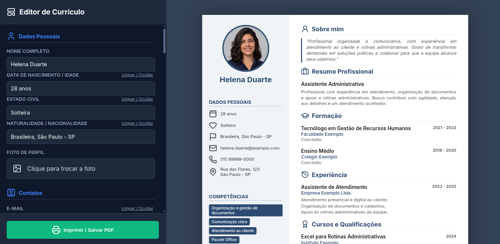

# 📄 Editor de Currículo Profissional (CV Builder)

<p align="center">
  
</p>

<p align="center">
  <b>Um gerador e editor de currículos moderno, responsivo e em tempo real, desenvolvido em HTML5, CSS3 e JavaScript puro.</b>
</p>

<p align="center">
  
  
  
  
  
</p>

---

## 📌 Sobre o Projeto

O **Editor de Currículo Profissional** é uma aplicação web focada em simplicidade, produtividade e design elegante. Permite preencher informações pessoais, acadêmicas e profissionais em um painel lateral interativo com **visualização instantânea (*Live Preview*)** em formato A4, pronta para impressão ou exportação direta para PDF de alta fidelidade.

---

## ✨ Funcionalidades

- ⚡ **Live Preview em Tempo Real:** Conforme você digita no formulário, o currículo ao lado é atualizado instantaneamente.
- 🎓 **Cursos e Qualificações Dinâmicos:**
  - Adicione quantos cursos/certificações desejar através do botão `+ Adicionar Curso / Qualificação`.
  - Edição individual de título, data/período, instituição/plataforma e carga horária/detalhes.
  - Exclusão com um clique (`Remover`).
  - Ocultação automática da seção caso não haja cursos cadastrados.
- 🖼️ **Upload de Foto de Perfil:** Pré-visualização instantânea da foto via upload local (*FileReader API*).
- 🖨️ **Exportação para PDF / Impressão Perfeita:**
  - Configurado com CSS `@media print` e `@page { size: A4 }` para exportação limpa, sem elementos de interface ou barras de rolagem.
- 🎨 **Layout Elegante de 2 Colunas:**
  - **Barra Lateral:** Foto, nome e dados de contato com ícones modernos.
  - **Coluna Principal:** Resumo profissional, sobre mim, formação acadêmica, experiências e cursos/certificações.
- 🚀 **Sem Dependências Pesadas:** Funciona diretamente no navegador sem necessidade de Node.js, compilação ou frameworks pesados.

---

## 📂 Estrutura de Pastas

```text
├── editor.html                     # Interface completa do editor interativo (Formulários + Live Preview)
├── index.html                      # Entrada do projeto; abre o editor automaticamente
├── template_original.html          # Modelo estático de currículo de exemplo
├── assets/preview-editor.png        # Captura de tela da interface do editor
├── demo-profile.png                # Foto de perfil fictícia usada no exemplo
├── LICENSE                         # Licença MIT
└── README.md                       # Documentação do projeto
```

---

## 🚀 Como Executar o Projeto

Como o projeto é desenvolvido com tecnologias web nativas, **não é necessário instalar nenhuma dependência**.

### Opção 1: Abrir diretamente no navegador
Basta dar dois cliques no arquivo `editor.html` ou abri-lo pelo seu navegador favorito (Chrome, Firefox, Edge, etc.).

### Opção 2: Usar o Live Server (VS Code / Antigravity)
1. Instale a extensão **Live Server** (se estiver usando VS Code).
2. Clique com o botão direito no arquivo `editor.html` e selecione **"Open with Live Server"**.
3. Acesse em `http://127.0.0.1:5500/editor.html`.

---

## 🖨️ Como Exportar para PDF com Qualidade Máxima

1. Abra o `editor.html` e preencha seus dados.
2. Clique no botão verde **"Imprimir / Salvar PDF"** (ou use o atalho `Ctrl + P` / `Cmd + P`).
3. Na janela de impressão:
   - **Destino:** Escolha `Salvar como PDF` (*Save as PDF*).
   - **Tamanho do Papel:** `A4`.
   - **Margens:** `Nenhuma` ou `Padrão`.
   - **Opções:** Marque a opção **"Gráficos de segundo plano"** (*Background graphics*) para que as cores de fundo e barras laterais sejam impressas perfeitamente.
4. Clique em **Salvar**.

---

## 🛠️ Tecnologias Utilizadas

- **HTML5 Semântico:** Estruturação acessível e clara.
- **CSS3 Moderno:** Flexbox, CSS Grid, variáveis CSS (`:root`), regras de impressão `@media print` e `@page`.
- **JavaScript (ES6+):** Manipulação de DOM, vinculação de eventos em tempo real e FileReader API.
- **[Lucide Icons](https://lucide.dev/):** Biblioteca moderna de ícones vetoriais em SVG.
- **[Inter Font](https://fonts.google.com/specimen/Inter):** Tipografia moderna e legível.

---

## 📄 Licença

Este projeto está licenciado sob a licença MIT - consulte o arquivo [LICENSE](LICENSE) para mais detalhes.

---

<p align="center">
  Desenvolvido por <b>Lucio Danilo</b>
</p>
